<p align="center">
  
</p>

<h1 align="center">rex-launchpad</h1>

<p align="center">
  <b>Your projects folder, one keystroke away in <a href="https://www.superlogical.com/rex">Rex</a>.</b><br>
  Jump between projects, start new ones, and pick up your Claude Code conversation where you left off.
</p>

<p align="center">
  
  
  
  
</p>

<p align="center">
  English · <a href="README.tr.md">Türkçe</a>
</p>

---

<table>
  <tr>
    <td width="33%" valign="top">
      <h3>⌘O &nbsp;Switch</h3>
      Every folder in your projects directory, in one floating panel. Type a few letters to filter, press Enter. Already open? You jump straight to its session.
    </td>
    <td width="33%" valign="top">
      <h3>+ &nbsp;Create</h3>
      Type a name that doesn't exist yet and press Enter. You get a new folder with <code>git init</code>, opened in its own session. Folders you make in Finder show up instantly.
    </td>
    <td width="33%" valign="top">
      <h3>↻ &nbsp;Resume</h3>
      New sessions start <a href="https://claude.com/claude-code">Claude Code</a> for you: <code>claude --continue</code> if the project has history, a fresh <code>claude</code> if not. Quit Claude and you're back in your shell.
    </td>
  </tr>
</table>

## Install

```sh
curl -fsSL https://raw.githubusercontent.com/itsyunusacar/rex-launchpad/main/install.sh | sh
```

Then press **⌘O** in Rex.

The installer clones the plugin into `~/.config/rex/launchpad`, adds two lines to your `init.lua` and reloads Rex. It picks the first of `~/Projects`, `~/Project`, `~/Developer` or `~/code` that exists as your projects folder. To choose a different folder or shortcut:

```sh
curl -fsSL https://raw.githubusercontent.com/itsyunusacar/rex-launchpad/main/install.sh | LAUNCHPAD_ROOT=~/work LAUNCHPAD_KEY=cmd+e sh
```

> [!IMPORTANT]
> Switching sessions from the panel needs **Rex Settings → Rex Server → Remote Control** turned on. Rex only accepts session changes from scripts when it is.

<details>
<summary>Install by hand</summary>

```sh
git clone https://github.com/itsyunusacar/rex-launchpad ~/.config/rex/launchpad
```

Add to `~/.config/rex/init.lua`:

```lua
local launchpad = dofile(os.getenv("HOME") .. "/.config/rex/launchpad/launchpad.lua")
launchpad.setup{ root = "~/Projects" }
```

Then run `rex config reload`.
</details>

## Use

| Key | Does |
| --- | --- |
| <kbd>⌘</kbd> <kbd>O</kbd> | Open the panel |
| type | Filter by letters in order: `wc` finds `web-components` |
| <kbd>↑</kbd> <kbd>↓</kbd> | Move |
| <kbd>↵</kbd> | Open the project, or create it if the name is new |
| <kbd>⌃</kbd> <kbd>N</kbd> | Create a project with the typed name |
| <kbd>⌃</kbd> <kbd>F</kbd> | Show the projects folder in Finder |
| <kbd>⌃</kbd> <kbd>U</kbd> | Clear the search |
| <kbd>esc</kbd> | Close |

Open projects (the ones with a Rex session) sit at the top with a green dot. The rest are sorted by when you last worked on them, using the folder and its git activity. Branches other than `main` and `master` are shown next to each project.

Every project is also in the command palette as **Project: name**.

## Configure

All options are optional.

```lua
launchpad.setup{
  root   = "~/Projects",  -- the folder whose subfolders are your projects
  key    = "cmd+o",       -- shortcut; false to bind nothing
  claude = true,          -- start Claude Code in new project sessions
  lang   = "auto",        -- "en", "tr", or "auto" to follow macOS
}
```

The command palette gets new folders after **Refresh Projects** or `rex config reload`. The panel itself always reads the folder live.

## How it works

Two small files, no dependencies beyond what macOS ships:

- **`launchpad.lua`** registers the Rex actions and the shortcut. Opening a project looks for a session labeled with the project's name. If there isn't one, it creates the session in the project folder, then asks Rex to show it.
- **`launchpad.py`** is the panel, a curses program that Rex runs in a floating pane. It lists the folder, reads each `.git/HEAD` for the branch, and calls back into Rex with `rex do launchpad_open`.

Claude Code keeps conversations per directory under `~/.claude/projects`, so the plugin checks that folder to choose between `claude --continue` and `claude`.

## Uninstall

Remove the two `launchpad` lines from `~/.config/rex/init.lua`, delete `~/.config/rex/launchpad` and run `rex config reload`.

## License

[MIT](LICENSE)
