<p align="center">
  
</p>

<h1 align="center">rex-launchpad</h1>

<p align="center">
  <b>Proje klasörün, <a href="https://www.superlogical.com/rex">Rex</a>'te tek tuş uzağında.</b><br>
  Projeler arasında geç, yenisini aç, Claude Code konuşmana kaldığın yerden devam et.
</p>

<p align="center">
  
  
  
  
</p>

<p align="center">
  <a href="README.md">English</a> · Türkçe
</p>

---

<table>
  <tr>
    <td width="33%" valign="top">
      <h3>⌘O &nbsp;Geç</h3>
      Proje klasöründeki her klasör tek bir yüzen panelde. Birkaç harf yaz, Enter'a bas. Proje zaten açıksa doğrudan onun oturumuna geçersin.
    </td>
    <td width="33%" valign="top">
      <h3>+ &nbsp;Oluştur</h3>
      Henüz olmayan bir ad yazıp Enter'a bas: <code>git init</code> yapılmış yeni bir klasör, kendi oturumunda açılır. Finder'da açtığın klasörler de anında listede görünür.
    </td>
    <td width="33%" valign="top">
      <h3>↻ &nbsp;Devam et</h3>
      Yeni oturumlar <a href="https://claude.com/claude-code">Claude Code</a>'u kendiliğinden başlatır: projede geçmiş varsa <code>claude --continue</code>, yoksa yeni bir <code>claude</code>. Claude'dan çıkınca kabuğa düşersin.
    </td>
  </tr>
</table>

## Kurulum

```sh
curl -fsSL https://raw.githubusercontent.com/itsyunusacar/rex-launchpad/main/install.sh | sh
```

Sonra Rex'te **⌘O**'ya bas.

Kurulum betiği eklentiyi `~/.config/rex/launchpad` klasörüne indirir, `init.lua` dosyana iki satır ekler ve Rex'i yeniden yükler. Proje klasörü olarak `~/Projects`, `~/Project`, `~/Developer` ve `~/code` içinden ilk bulduğunu seçer. Başka bir klasör ya da kısayol için:

```sh
curl -fsSL https://raw.githubusercontent.com/itsyunusacar/rex-launchpad/main/install.sh | LAUNCHPAD_ROOT=~/isler LAUNCHPAD_KEY=cmd+e sh
```

> [!IMPORTANT]
> Panelden oturum değiştirebilmek için **Rex Ayarlar → Rex Server → Remote Control** açık olmalı. Rex, betiklerden gelen oturum değişikliklerini ancak bu ayar açıkken kabul ediyor.

<details>
<summary>Elle kurulum</summary>

```sh
git clone https://github.com/itsyunusacar/rex-launchpad ~/.config/rex/launchpad
```

`~/.config/rex/init.lua` dosyasına ekle:

```lua
local launchpad = dofile(os.getenv("HOME") .. "/.config/rex/launchpad/launchpad.lua")
launchpad.setup{ root = "~/Projects" }
```

Sonra `rex config reload` çalıştır.
</details>

## Kullanım

| Tuş | Ne yapar |
| --- | --- |
| <kbd>⌘</kbd> <kbd>O</kbd> | Paneli açar |
| yazmak | Harfleri sırayla eşleştirir: `wc` yazınca `web-components` bulunur |
| <kbd>↑</kbd> <kbd>↓</kbd> | Seçimi taşır |
| <kbd>↵</kbd> | Projeyi açar; ad yeniyse projeyi oluşturur |
| <kbd>⌃</kbd> <kbd>N</kbd> | Yazılan adla yeni proje oluşturur |
| <kbd>⌃</kbd> <kbd>F</kbd> | Proje klasörünü Finder'da açar |
| <kbd>⌃</kbd> <kbd>U</kbd> | Aramayı temizler |
| <kbd>esc</kbd> | Kapatır |

Açık projeler (Rex oturumu olanlar) en üstte, yeşil noktayla durur. Diğerleri, klasördeki ve git'teki son hareketine göre en son çalıştığın üstte olacak şekilde sıralanır. `main` ve `master` dışındaki dallar projenin yanında görünür.

Her proje komut paletinde de **Proje: ad** olarak bulunur.

## Ayarlar

Hepsi isteğe bağlı.

```lua
launchpad.setup{
  root   = "~/Projects",  -- alt klasörleri projelerin olan klasör
  key    = "cmd+o",       -- kısayol; hiçbir tuşa bağlamamak için false
  claude = true,          -- yeni proje oturumlarında Claude Code'u başlat
  lang   = "auto",        -- "en", "tr" ya da macOS dilini izlemek için "auto"
}
```

Komut paleti yeni klasörleri **Projeleri Yenile** ya da `rex config reload` sonrası görür. Panelin kendisi klasörü her zaman canlı okur.

## Nasıl çalışır

macOS'ta zaten olanlar dışında bağımlılığı olmayan iki küçük dosya:

- **`launchpad.lua`** Rex komutlarını ve kısayolu tanımlar. Bir projeyi açarken o projenin adını taşıyan oturumu arar. Yoksa proje klasöründe yeni oturum açar, sonra Rex'ten onu göstermesini ister.
- **`launchpad.py`** panelin kendisi; Rex'in yüzen bir panelde çalıştırdığı bir curses programı. Klasörü listeler, dal için her projenin `.git/HEAD` dosyasını okur ve `rex do launchpad_open` ile Rex'e geri döner.

Claude Code konuşmaları klasöre göre `~/.claude/projects` altında tutar. Eklenti `claude --continue` ile `claude` arasında seçim yapmak için bu klasöre bakar.

## Kaldırma

`~/.config/rex/init.lua` içindeki iki `launchpad` satırını sil, `~/.config/rex/launchpad` klasörünü sil ve `rex config reload` çalıştır.

## Lisans

[MIT](LICENSE)
